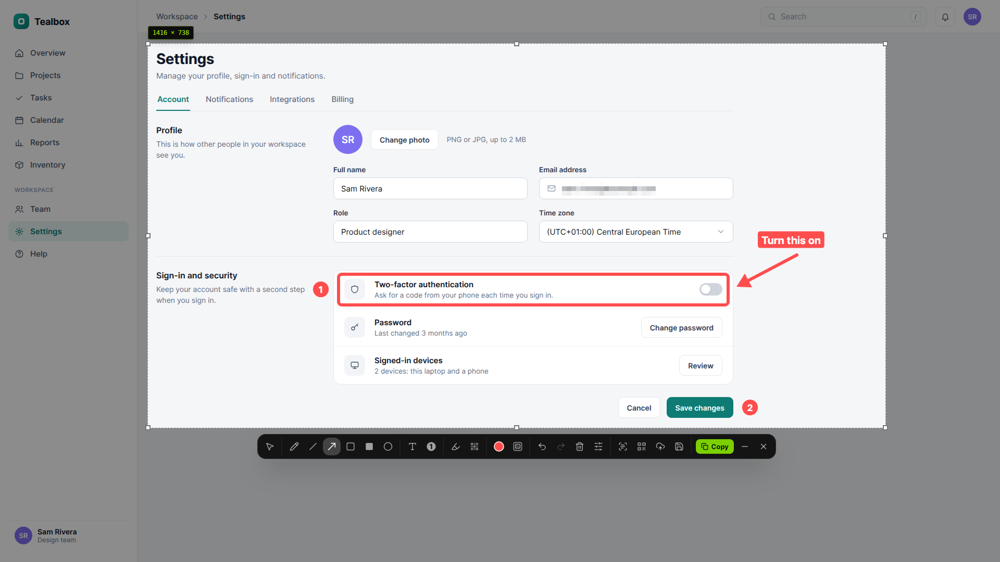

# Screention

A free screenshot tool for Linux, Windows and macOS, made by [Gkernel](https://gkernel.com).

[Website](https://screention.gkernel.com) · [Download](https://screention.gkernel.com/download) · [User guide](https://screention.gkernel.com/docs) · [Changelog](https://screention.gkernel.com/changelog)

This repository hosts the release downloads. The source code is not public.

## What it does

- Press Ctrl+Alt+A (Cmd+Option+A on macOS), or choose Take screenshot from the tray menu, and select part of the screen.
- Mark it up with arrows, lines, rectangles, ellipses, the pen, text, numbered steps, highlight, blur and a solid box. Every tool has its own options, and you can move, resize and edit what you drew.
- Add an optional background with padding, rounded corners and a shadow.
- Copy the text in a screenshot. English is built in, and 22 more languages can be downloaded in Settings.
- Read QR codes and barcodes.
- Copy, save, or upload to get a share link. Screention asks before the first upload, and anyone with the link can see the image.
- Find saved screenshots in the gallery, with notes and search.

## Download

Get the latest version from the [download page](https://screention.gkernel.com/download) or the [releases page](https://github.com/gkernel247/screention-releases/releases/latest).

| Platform | Files |
| --- | --- |
| Linux x86_64: Ubuntu 22.04, Debian 12, Linux Mint 21, Fedora 38 or newer | `.deb`, `.rpm`, `.AppImage` (needs FUSE 2) |
| Windows 10 and 11, x64 | setup `.exe`, `.msi` |
| macOS, Intel and Apple Silicon | `.dmg` |

The macOS app is not notarized by Apple yet. On macOS 15 and later, open it once, click Done, then go to System Settings > Privacy & Security and click Open Anyway.

Each release since 0.13.0 includes a `SHA256SUMS` file for checking the downloads.

## Privacy

Your screenshots stay on your computer unless you upload one. By default, Screention sends usage counts tied to a random install ID: which features are used, the app version and basic system details, never screenshots or their text. You can turn this off in Settings > Privacy. It also checks once a day for a new version. Details are in the [privacy policy](https://screention.gkernel.com/privacy-policy).

## Help

Use Messages inside the app to report a problem or ask a question, or email contact@gkernel.com.

## License

Screention is free to download and use under its [terms](https://screention.gkernel.com/terms-and-conditions). Copyright © 2025-2026 Gkernel.
