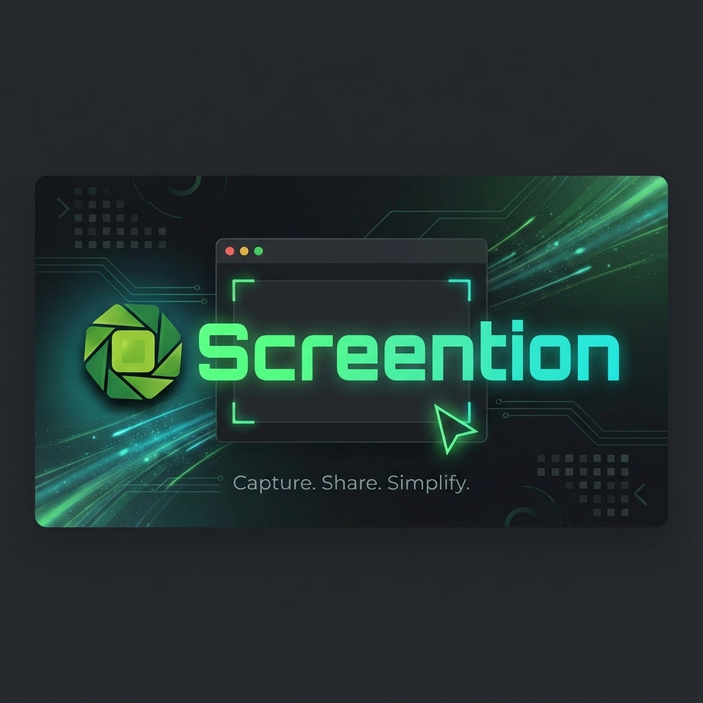

# Screention 📸

**Capture key moments in style.**

Screention is a beautiful, cross-platform screen capture tool designed for everyone. Turn your daily screenshots into polished, shareable masterpieces instantly.

## ✨ Features

- **Precision Capture**: Select exactly what you want to share.
- **Rich Annotations**:
  - 🏹 **Arrows** to point out details
  - 🔲 **Shapes** to frame content
  - 💧 **Blur** to hide sensitive info like emails or API keys
  - 🔦 **Highlight** to focus attention
- **Instant Style**: Automatically adds beautiful backgrounds and padding so your screenshots look professional by default.
- **Privacy First**: Everything stays on your computer. No cloud uploads unless you choose to share.

## 📥 Download

Get the latest version for your computer from the **[Releases Page](https://github.com/gkernel247/screention-releases/releases)**.

| Platform | Supported? |
|----------|------------|
| **Windows** | ✅ Yes |
| **macOS**   | ✅ Yes |
| **Linux**   | ✅ Yes |

## 🚀 How it Works

1. **Snap**: Press `Ctrl` + `Alt` + `A` (or `Cmd` + `Alt` + `A` on Mac) to start.
2. **Annotate**: Draw arrows, shapes, or blur content instantly.
3. **Share**: Copy to clipboard or save to your desktop.

## 📄 License

MIT © [Gkernel](https://gkernel.com)
